<!-- ============================== BANNER ============================== -->
<a href="https://github.com/Saadia-Asghar">
  
</a>

<!-- ============================== TYPING ============================== -->
<p align="center">
  <a href="https://github.com/Saadia-Asghar">
    
  </a>
</p>


<!-- ============================== MORE TYPING (added) ============================== -->
<p align="center">
  <a href="https://portfoliosaadia.vercel.app/">
    
  </a>
</p>

<p align="center">
  <a href="https://portfoliosaadia.vercel.app/">
    
  </a>
</p>

<!-- ============================== NOW WIDGET ============================== -->
<p align="center">
  
  
  
  
  
</p>

<!-- ============================== METRICS STRIP ============================== -->
<p align="center">
  
  
  
</p>

<br />

<!-- ============================== QUICK NAV ============================== -->
<p align="center">
  <a href="#-saadiajson-"></a>
  <a href="#-character-sheet-"></a>
  <a href="#-ship-log-"></a>
  <a href="#-wall-of-wins-"></a>
  <a href="#-my-tech-love-language-"></a>
  <a href="#-projects-im-low-key-proud-of-"></a>
  <a href="#-lets-actually-be-friends-"></a>
  <a href="#-the-roles-im-actually-in-"></a>
  <a href="#-hey-the-tech-side-"></a>
  <a href="#-hey-the-design-side-"></a>
</p>

<br />

<!-- ============================== BOOT SEQUENCE ============================== -->
<div align="center">

```ansi
[38;5;141m$[0m saadia --whoami
[38;5;240m──────────────────────────────────────────────[0m
[38;5;141m[ ✓ ][0m booting saadia.os v3.2.1 [████████████] 100%
[38;5;141m[ ✓ ][0m mounting personality.fs ...................... ok
[38;5;141m[ ✓ ][0m loading hackathon_wins.json (4 entries) ....... ok
[38;5;141m[ ✓ ][0m injecting chai into bloodstream ............... critical
[38;5;141m[ ✓ ][0m daemon ship_the_thing.service ................. running

[38;5;213m> hi, i'm saadia ✦ data science undergrad @ giki[0m
[38;5;213m> currently shipping: callpilot · ecobite · skil_issue[0m
[38;5;213m> status: vibing in vs code @ 2:47 a.m. (peak performance)[0m
```

</div>


<!-- extra boot lines, same terminal, nothing above was touched -->
<div align="center">

```ansi
[38;5;141m$[0m saadia --tech
[38;5;213m> callpilot · skil_issue · ecobite · chainticket · moodmaze[0m
[38;5;213m> research · kg-rag · biomedical retrieval[0m
[38;5;213m> najoomi · jul–sep 2026 · memory, rag, quicktalk pinecone[0m
```

</div>

<!-- ============================== HERO CONNECT CTA ============================== -->
<div align="center">

```diff
+ ✨ psst — i'm saadia.  let's be internet friends ✨
- (yes, you, person reading my github at 2am)
+ slide into my dms — linkedin for collabs, instagram for the vibes 💌
```

</div>

<p align="center">
  <a href="https://www.linkedin.com/in/saadia-asghar" target="_blank">
    
  </a>
  &nbsp;&nbsp;
  <a href="https://www.instagram.com/s._bytes/" target="_blank">
    
  </a>
</p>


<p align="center">
  <a href="https://www.instagram.com/saadiaasghar_" target="_blank">
    
  </a>
  &nbsp;&nbsp;
  <a href="https://portfoliosaadia.vercel.app/" target="_blank">
    
  </a>
</p>

<p align="center">
  <sub>📩 dm's are <b>always open</b> — hackathons, coffee chats, study buddies, cool ideas, fanmail (kidding) (...unless?)</sub>
</p>

<!-- thin gradient divider -->
<p align="center"></p>

<br />

<!-- ============================== SAADIA.JSON ============================== -->
<h2 align="center">✦ saadia.json ✦</h2>

<p align="center">
  <sub>my runtime profile, lovingly formatted 🧃</sub>
</p>

<br />

<table align="center">
  <tr>
    <td valign="top">

```jsonc
{
  "name":         "Saadia Asghar",
  "type":         "human.v3.2.1",
  "version":      "junior.dev.2026",
  "status":       "ONLINE 🟢",
  "location":     "Pakistan 🇵🇰",
  "role":         "data science undergrad @ GIKI",

  "now_playing": {
    "code":      "Skill_issue · Next.js 15",
    "song":      "tbd — check spotify ↓",
    "thought":   "what if we used vector embeddings for..."
  },

  "active_quests": ["CallPilot 🤖", "EcoBite 🌱", "skil_issue 🕹️"],
  "side_quests":   ["Azure ☁️", "GenAI Agents 🧠", "advanced Python 🐍"],

  "vibes":         ["AI", "data", "social impact", "creative coding"],
  "ask_me_about":  ["data science", "SQL", "product design", "hackathons"],

  "fun_fact":      "i name my plants after my favorite algorithms",
  "philosophy":    "ship messy. iterate kindly. celebrate loudly.",
  "email":         "saadianigah@gmail.com",
  "open_to":       "collabs on AI + impact-driven projects"
}
```

</td>
  </tr>
</table>

<br />

<!-- thin gradient divider -->
<p align="center"></p>

<!-- ============================== CHARACTER SHEET ============================== -->
<h2 align="center">✦ character sheet ✦</h2>

<p align="center">
  <sub>level 3 data science undergrad · class: <b>builder/strategist</b> · alignment: <b>chaotic helpful</b></sub>
</p>

<br />

<table align="center">
  <tr>
    <td>

```
┌─────────────────────────────────────────────────────────────┐
│  STR  ·  full-stack development            ████████░░  82%  │
│  INT  ·  data science & ml                 █████████░  90%  │
│  DEX  ·  product design / figma            ████████░░  78%  │
│  WIS  ·  hackathon strategy                █████████░  88%  │
│  CHA  ·  pitching ideas to humans          ████████░░  85%  │
│  LCK  ·  finding bugs at the worst time    ██████████  99%  │
└─────────────────────────────────────────────────────────────┘
   ⚡ special move:  "i'll just stay up one more hour"
   🎒 inventory:     vscode · figma · chai · spotify premium · vibes
   🛡️ resistances:   imposter syndrome (advanced), rejection (mid)
   💎 weakness:      seeing a good dataset & wanting to play with it
```

</td>
  </tr>
</table>

<br />

<details align="center">
<summary><b>📈 fun stats (no actual science was done here)</b></summary>

<br />

```
commits made between midnight and 4 a.m. ............ ████████░░  78%
coffee : code ratio ................................. 1 ☕ : 1.2 PR
"it works on my machine" instances .................. 6 (last week)
plants killed despite naming them after algorithms ... 2 (RIP DFS, ε-greedy)
times git reset --hard saved me ..................... 14
times git reset --hard ruined me .................... 1 (we don't talk about it)
hackathons survived this year ....................... 5
sleep schedule ...................................... 404 not found
```

</details>

<br />

<!-- mood badges -->
<p align="center">
  
  
  
</p>

<br />

<!-- thin gradient divider -->
<p align="center"></p>


<!-- ============================== TECH + RESEARCH (added) ============================== -->
<p align="center">
  
</p>

<p align="center">
  
</p>

<h2 align="center" id="-hey-the-tech-side-">✦ hey, the tech side ✦</h2>

<p align="center">
  <sub>live demos and the repos 🤖</sub>
</p>

<div align="center">

```ansi
[38;5;141m$[0m ls ~/builds
[38;5;213m> skil_issue    callpilot    ecobite       chainticket[0m
[38;5;213m> giki-connect  moodmaze     quicktalk     darzi-khata[0m
[38;5;213m> donorbridge   effortscope  water         hunar-naqsha[0m
```

</div>

<p align="center">
  <a href="https://skill-issue-s1oh.vercel.app/"></a>
  <a href="https://callpilot-control.vercel.app"></a>
  <a href="https://ecobite-iota.vercel.app"></a>
  <a href="https://chain-ticket.vercel.app"></a>
  <a href="https://moodmaze.vercel.app"></a>
  <a href="https://portfoliosaadia.vercel.app/"></a>
</p>

<br />

<table align="center">
  <tr>
    <td>

| build | what it does | open |
| --- | --- | --- |
| skil_issue | 2nd · Hack Git. teaching style that sticks, then quizzes and 1v1 blitz | [live](https://skill-issue-s1oh.vercel.app/) · [code](https://github.com/Saadia-Asghar/Skill_issue) |
| CallPilot | Top 10 · MIT Hack-Nation. calls, memory, scheduling | [live](https://callpilot-control.vercel.app) · [code](https://github.com/Saadia-Asghar/callpilot-control) |
| EcoBite | Imagine Cup, with Fatima Tuz Zahra. surplus food, Azure | [live](https://ecobite-iota.vercel.app) · [code](https://github.com/Saadia-Asghar/Ecobite_) |
| ChainTicket | 3rd · BASE Web3. tickets checked on-chain, not by screenshot | [live](https://chain-ticket.vercel.app) · [code](https://github.com/Saadia-Asghar/Chain_ticket) |
| GIKI-Connect | who actually meets whom on campus. chi-square, k-means, a silo index | [live](https://saadia-asghar.github.io/Giki-Connect/) · [code](https://github.com/Saadia-Asghar/Giki-Connect) |
| MoodMaze | a mood in, three films out. TMDB plus a max-heap | [live](https://moodmaze.vercel.app) · [code](https://github.com/Saadia-Asghar/Mood_Maze) |
| QuickTalk | Najoomi. Flask and Pinecone. a three-bullet handoff for the next agent | [code](https://github.com/Saadia-Asghar/quicktalk-pinecone-memory) |
| Darzi Khata | offline ledger for a tailor. Urdu and English | [code](https://github.com/Saadia-Asghar/darzi-khata) |
| DonorBridge | donor questions answered from Postgres, every turn logged | [code](https://github.com/Saadia-Asghar/DonorBridge) |
| EffortScope | local tracker for who is carrying the group project | [code](https://github.com/Saadia-Asghar/Effort_Scope) |
| water potability | Naive Bayes on 800 samples. when to change the filter | [code](https://github.com/Saadia-Asghar/water-probability-project) |
| Hunar Naqsha | Google AI Seekho. people who need a craft, makers already booked | [code](https://github.com/Saadia-Asghar/Hunar-Naqsha) |

</td>
  </tr>
</table>

<br />

<!-- ============================== DESIGN SIDE (added) ============================== -->
<p align="center">
  
</p>

<h2 align="center" id="-hey-the-design-side-">✦ hey, the design side ✦</h2>

<p align="center">
  <sub>the one other side. Canva is where the imagination becomes the color, then the file keeps it.</sub>
</p>

<p align="center">
  <a href="https://canva.link/nllc230n1faj0h6"></a>
  <a href="https://canva.link/2gr7145jlbx0ttr"></a>
  <a href="https://canva.link/nfvzr08alsqq9r9"></a>
  <a href="https://canva.link/e92p1vc5liwinkp"></a>
</p>

<table align="center">
  <tr>
    <td align="center" width="25%">
      <a href="https://www.figma.com/design/E9IKt31asTEeVyKS595YX3/Vyro?node-id=4-17&t=jjLeblvLTYZQ2yTd-1">
        
      </a>
      <br/><sub><b>Vyrothon</b><br/>1st product design</sub>
    </td>
    <td align="center" width="25%">
      <a href="https://www.figma.com/design/yw4reHaM5S3p0WADMxoo2X/Call-Pilot?node-id=11-2&t=9ir8e8FNP0r0qLEj-1">
        
      </a>
      <br/><sub><b>CallPilot</b><br/>product screen</sub>
    </td>
    <td align="center" width="25%">
      <a href="https://canva.link/e92p1vc5liwinkp">
        
      </a>
      <br/><sub><b>ACM GIKI</b><br/>poster</sub>
    </td>
    <td align="center" width="25%">
      <a href="https://canva.link/2gr7145jlbx0ttr">
        
      </a>
      <br/><sub><b>PreMed.PK</b><br/>education deck</sub>
    </td>
  </tr>
  <tr>
    <td align="center" width="25%">
      <a href="https://www.figma.com/design/ZZ259rh7azNEfkHnmRLywl/ChainTicket?node-id=0-1&t=EadmwPrVzE99VRTb-1">
        
      </a>
      <br/><sub><b>ChainTicket</b><br/>product screen</sub>
    </td>
    <td align="center" width="25%">
      <a href="https://www.figma.com/design/HlnuZL5J1Wk8q6xaAseJ8F/Mood-Maze?t=b3mlhQ4jSQqs94QJ-1">
        
      </a>
      <br/><sub><b>MoodMaze</b><br/>product screen</sub>
    </td>
    <td align="center" width="25%">
      <a href="https://canva.link/nfvzr08alsqq9r9">
        
      </a>
      <br/><sub><b>MLSA</b><br/>signage</sub>
    </td>
    <td align="center" width="25%">
      <a href="https://portfoliosaadia.vercel.app/#design">
        
      </a>
      <br/><sub><b>the rest of the desk</b><br/>four collections</sub>
    </td>
  </tr>
</table>

<p align="center">
  <a href="https://portfoliosaadia.vercel.app/#design">
    
  </a>
</p>

<br />

<p align="center">
  
</p>

<h2 align="center">✦ hey, the research side ✦</h2>

<p align="center">
  <sub>KG-RAG and RMF-RAG on biomedical retrieval 🎓</sub>
</p>

<div align="center">

```ansi
[38;5;141m$[0m saadia --research
[38;5;213m> repo: kg-rag-rmf-rag-research[0m
[38;5;213m> pilot: KG-RAG vs RMF-RAG on biomedical retrieval[0m
[38;5;213m> question: where retrieval stops a multi-hop answer from inventing the bridge[0m
[38;5;213m> collab: research and projects are open[0m
[38;5;213m> hey, let's collaborate[0m
```

</div>

<p align="center">
  <a href="https://github.com/Saadia-Asghar/kg-rag-rmf-rag-research">
    
  </a>
  &nbsp;
  <a href="https://github.com/Saadia-Asghar/quicktalk-pinecone-memory">
    
  </a>
</p>

<p align="center">
  <sub>Najoomi · July–September 2026 · retrieval, memory layers, and that QuickTalk service</sub>
</p>

<p align="center">
  <sub>open for research collaborations and projects</sub>
</p>

<p align="center">
  <a href="mailto:saadianigah@gmail.com">
    
  </a>
  &nbsp;
  <a href="https://github.com/Saadia-Asghar/kg-rag-rmf-rag-research">
    
  </a>
  &nbsp;
  <a href="https://portfoliosaadia.vercel.app/#work">
    
  </a>
</p>

<br />

<!-- ============================== ROLES (added) ============================== -->
<h2 align="center" id="-the-roles-im-actually-in-">✦ the roles i'm actually in ✦</h2>

<p align="center">
  <sub>the group chat, but make it a table 🧃</sub>
</p>

<br />

<table align="center">
  <tr>
    <td>

| quest | class | status |
| --- | --- | --- |
| UROG | Director of Marketing | active · May 2026 · the post sits on the executive council · Officer Education before that |
| Canva | Ambassador + community lead | active |
| Replit | Campus Ambassador · HackSummer Islamabad | active |
| atomcamp | Campus Ambassador | active |
| GDGoC GIKI | Core team | ended |
| Hult Prize, GIKI | Sponsorship Lead | active · Oct 2026 |
| Microsoft Club | Head of Marketing | active |
| Discuss | Founder | active |
| HeyOz | Ambassador | active |
| Comebck Pakistan | AI Fellow | ended · ranked #1 · Sweet Tooth |
| AWS Outreach, GIKI | Outreach Lead | ended · Aug–Oct 2026 |
| Najoomi | AI Intern | ended · Jul–Sep 2026 |
| PreMed.PK | Design associate | ended · May 2025–Jan 2026 |

</td>
  </tr>
</table>

<br />

<p align="center"></p>

<!-- ============================== SHIP LOG ============================== -->
<h2 align="center">✦ ship log ✦</h2>

<p align="center">
  <sub>receipts, but make it chronological 🚢</sub>
</p>

<br />

<table align="center">
  <tr>
    <td>

```
2026  ┃
      ┃  🕹️  skil_issue            →  2nd place · Hack Git Hackathon
      ┃  🤖  CallPilot             →  Top 10 globally · MIT Hack-Nation
      ┃
2025  ┃
      ┃  🌱  EcoBite               →  Microsoft Imagine Cup project
      ┃  🎟️  ChaInTicket+         →  3rd place · Nationwide Hackathon
      ┃  📊  EffortScope            →  shipped (in active use)
      ┃
2024  ┃
      ┃  🎬  MoodMaze               →  rule-based recsys, TMDB integration
      ┃  🎓  joined GIKI            →  data science · year one unlocked
      ┃
      ●  next  ┐
               │  hint: it involves agents 👀
               ┘
```

</td>
  </tr>
</table>

<br />


<p align="center">
  <sub>research and the other builds, linked 🔗</sub>
</p>

<p align="center">
  <a href="https://github.com/Saadia-Asghar/kg-rag-rmf-rag-research"></a>
  <a href="https://github.com/Saadia-Asghar/quicktalk-pinecone-memory"></a>
  <a href="https://github.com/Saadia-Asghar/Giki-Connect"></a>
  <a href="https://github.com/Saadia-Asghar/darzi-khata"></a>
  <a href="https://github.com/Saadia-Asghar/DonorBridge"></a>
  <a href="https://github.com/Saadia-Asghar/Effort_Scope"></a>
  <a href="https://github.com/Saadia-Asghar/water-probability-project"></a>
  <a href="https://github.com/Saadia-Asghar/Hunar-Naqsha"></a>
</p>

<br />

<!-- ============================== YES / NO ============================== -->
<h2 align="center">✦ the energy i'm bringing in 2026 ✦</h2>

<br />

<table align="center" width="100%">
  <tr>
    <td width="50%" align="left" valign="top">

**`saying yes to ✅`**

- shipping at 80% > waiting for 100%
- dashboards with personality
- hackathons (yes, even at 2am)
- mentoring juniors and being mentored
- weird side projects on purpose
- coffee chats with internet strangers
- docs so future-saadia doesn't suffer

</td>
    <td width="50%" align="left" valign="top">

**`saying no to ❌`**

- gatekeeping tutorials
- "boring" enterprise dashboards
- meetings that should've been a slack
- PRs without a description
- frameworks of the week (i'm picky now)
- 4 a.m. bugs (you've had your fun)
- things that don't spark something

</td>
  </tr>
</table>

<br />

<!-- thin gradient divider -->
<p align="center"></p>

<!-- ============================== WALL OF WINS ============================== -->
<h2 align="center">✦ wall of wins ✦</h2>

<p align="center">
  <sub>the little gold stars on my dev resume 🌟</sub>
</p>

<br />

<table align="center">
  <tr>
    <td align="center" width="25%">
      <h3>🥈</h3>
      <b>2nd Place</b><br/>
      <sub>Hack Git Hackathon</sub><br/>
      <sub><i>skil_issue</i></sub>
    </td>
    <td align="center" width="25%">
      <h3>🏅</h3>
      <b>Top 10 Globally</b><br/>
      <sub>MIT Hack-Nation</sub><br/>
      <sub><i>CallPilot</i></sub>
    </td>
    <td align="center" width="25%">
      <h3>🥉</h3>
      <b>3rd Place</b><br/>
      <sub>Nationwide Blockchain</sub><br/>
      <sub><i>ChaInTicket+</i></sub>
    </td>
    <td align="center" width="25%">
      <h3>🏆</h3>
      <b>Imagine Cup</b><br/>
      <sub>Microsoft</sub><br/>
      <sub><i>EcoBite</i></sub>
    </td>
  </tr>
</table>

<br />


<table align="center">
  <tr>
    <td align="center" width="25%">
      <h3>🧪</h3>
      <b>QuickTalk</b><br/>
      <sub>Najoomi · Pinecone</sub><br/>
      <sub><i><a href="https://github.com/Saadia-Asghar/quicktalk-pinecone-memory">memory handoff</a></i></sub>
    </td>
    <td align="center" width="25%">
      <h3>🥇</h3>
      <b>#1 cohort</b><br/>
      <sub>Comebck Pakistan</sub><br/>
      <sub><i>Sweet Tooth</i></sub>
    </td>
    <td align="center" width="25%">
      <h3>🤖</h3>
      <b>memory era</b><br/>
      <sub>Najoomi</sub><br/>
      <sub><i>jul–sep 2026</i></sub>
    </td>
    <td align="center" width="25%">
      <h3>🎓</h3>
      <b>research</b><br/>
      <sub>biomedical retrieval</sub><br/>
      <sub><i><a href="https://github.com/Saadia-Asghar/kg-rag-rmf-rag-research">KG-RAG</a></i></sub>
    </td>
  </tr>
</table>

<br />

<!-- thin gradient divider -->
<p align="center"></p>

<!-- ============================== TECH STACK ============================== -->
<h2 align="center">✦ my tech love language ✦</h2>

<p align="center">
  <sub>the stack i've been romantically involved with 💜</sub>
</p>

<br />

<p align="center"><b>languages</b></p>
<p align="center">
  <a href="https://skillicons.dev">
    
  </a>
</p>

<p align="center"><b>frameworks & data</b></p>
<p align="center">
  <a href="https://skillicons.dev">
    
  </a>
</p>

<p align="center"><b>cloud, db & daily drivers</b></p>
<p align="center">
  <a href="https://skillicons.dev">
    
  </a>
</p>

<p align="center"><b>design corner</b></p>
<p align="center">
  <a href="https://skillicons.dev">
    
  </a>
  
  
</p>

<br />

<!-- thin gradient divider -->
<p align="center"></p>

<!-- ============================== GITHUB STATS ============================== -->
<h2 align="center">✦ the github receipts ✦</h2>

<p align="center">
  <sub>numbers don't lie, but they do flex 📊</sub>
</p>

<br />

<p align="center">
  <a href="https://github.com/Saadia-Asghar">
    
    
  </a>
</p>

<p align="center">
  <a href="https://github.com/Saadia-Asghar">
    
  </a>
</p>

<p align="center">
  
</p>

<!-- snake animation (renders from output branch via Platane/snk) -->
<p align="center">
  <picture>
    <source media="(prefers-color-scheme: dark)" srcset="https://raw.githubusercontent.com/Saadia-Asghar/Saadia-Asghar/output/github-contribution-grid-snake-dark.svg" />
    <source media="(prefers-color-scheme: light)" srcset="https://raw.githubusercontent.com/Saadia-Asghar/Saadia-Asghar/output/github-contribution-grid-snake.svg" />
    
  </picture>
</p>

<details align="center">
<summary><b>🏆 see github trophies</b></summary>

<br />

<p align="center">
  
</p>

</details>

<br />

<!-- thin gradient divider -->
<p align="center"></p>

<!-- ============================== PINNED ============================== -->
<h2 align="center">✦ pinned & proud ✦</h2>

<p align="center">
  <sub>live card — star count updates in real-time ⭐</sub>
</p>

<br />

<p align="center">
  <a href="https://github.com/Saadia-Asghar/Skill_issue">
    
  </a>
</p>

<p align="center">
  <a href="https://github.com/Saadia-Asghar/callpilot-control">
    
  </a>
  <a href="https://github.com/Saadia-Asghar/Ecobite_">
    
  </a>
</p>

<p align="center">
  <a href="https://github.com/Saadia-Asghar/Chain_ticket">
    
  </a>
  <a href="https://github.com/Saadia-Asghar/kg-rag-rmf-rag-research">
    
  </a>
</p>

<br />

<!-- ============================== FEATURED PROJECTS ============================== -->
<h2 align="center">✦ projects i'm low-key proud of ✦</h2>

<p align="center">
  <sub>the receipts, but make it portfolio 💅</sub>
</p>

<br />

<table align="center">
  <tr>
    <td width="50%" valign="top">
      <h3 align="center"><a href="https://github.com/Saadia-Asghar/Skill_issue">skil_issue 🕹️</a></h3>
      <p align="center"><em>the cognitive arena — leetcode of learning</em><br/>
        
      </p>
      <p>
        an arcade-style study platform that figures out which learning style actually sticks for you.
        <br/><br/>
        ✦ <b>influencer personas</b> turn dry text into viral-style explanations<br/>
        ✦ <b>1v1 blitz</b> + global dean's list elo leaderboard<br/>
        ✦ <b>Next.js 15 + Supabase + Clerk + Vercel AI SDK</b>
      </p>
    </td>
    <td width="50%" valign="top">
      <h3 align="center">CallPilot 🤖</h3>
      <p align="center"><em>AI assistant platform</em><br/>
        
      </p>
      <p>
        an ai that actually <i>does</i> the boring stuff so you don't have to.
        <br/><br/>
        ✦ designed the full product workflow from problem → prototype<br/>
        ✦ architected an <b>AI-driven automation engine</b><br/>
        ✦ ranked <b>top 10 globally</b> at mit hack-nation
      </p>
    </td>
  </tr>
  <tr>
    <td width="50%" valign="top">
      <h3 align="center">EcoBite 🌱</h3>
      <p align="center"><em>food waste management platform</em><br/>
        
      </p>
      <p>
        rescuing food before it hits the bin — at scale.
        <br/><br/>
        ✦ donation flow for <b>5 distinct user roles</b><br/>
        ✦ NGO & recycler dashboards on <b>Azure AD B2C</b><br/>
        ✦ moving <b>500+ meals / week</b>, +30% donations
      </p>
    </td>
    <td width="50%" valign="top">
      <h3 align="center">ChaInTicket+ 🎟️</h3>
      <p align="center"><em>blockchain ticketing system</em><br/>
        
      </p>
      <p>
        fake tickets? not in this economy.
        <br/><br/>
        ✦ on-chain QR verification (zero fraud)<br/>
        ✦ organizer dashboards for <b>1000+ attendees</b><br/>
        ✦ fully automated QR validation pipeline
      </p>
    </td>
  </tr>
</table>

<br />

<details align="center">
<summary><b>🎁 there's more — click for the b-sides</b></summary>

<br />

<table align="center">
  <tr>
    <td width="50%" valign="top">
      <h3 align="center">MoodMaze 🎬</h3>
      <p align="center"><em>mood-based movie recommender</em><br/>
        
      </p>
      <p>
        for when you've scrolled netflix for 40 minutes and given up.
        <br/><br/>
        ✦ rule-based recommendation algorithm<br/>
        ✦ integrated <b>TMDB API</b><br/>
        ✦ Firebase Auth + Firestore backend
      </p>
    </td>
    <td width="50%" valign="top">
      <h3 align="center">EffortScope 📊</h3>
      <p align="center"><em>team contribution tracker</em></p>
      <p>
        a productivity tool that shows who's actually carrying the group project.
        <br/><br/>
        ✦ real-time contribution tracking<br/>
        ✦ role-based team management<br/>
        ✦ clean analytics for collab tech teams
      </p>
    </td>
  </tr>
</table>

</details>

<br />

<!-- thin gradient divider -->
<p align="center"></p>

<!-- ============================== NOW PLAYING ============================== -->
<h2 align="center">✦ currently on repeat ✦</h2>

<p align="center">
  <a href="https://open.spotify.com/user/saadia">
    
  </a>
</p>

<p align="center">
  <sub>🎧 the soundtrack to my late-night commits</sub>
</p>

<br />

<details align="center">
<summary><b>🎓 certified glow-ups (click to expand)</b></summary>

<br />

<p align="center">
  
  
  
  
  
</p>

</details>

<br />

<!-- thin gradient divider -->
<p align="center"></p>

<!-- ============================== BIG CONNECT CTA ============================== -->
<h2 align="center">✦ let's actually be friends ✦</h2>

<p align="center">
  <b>okay you made it this far — you're basically my bestie now 💖</b><br/>
  here's where to find me. i promise i reply (eventually):
</p>

<br />

<table align="center">
  <tr>
    <td align="center" width="33%">
      <a href="https://www.linkedin.com/in/saadia-asghar" target="_blank">
        
      </a>
      <br/><br/>
      <sub>💼 <b>linkedin</b><br/>collabs, opps,<br/>referrals, recs</sub>
    </td>
    <td align="center" width="33%">
      <a href="https://www.instagram.com/s._bytes/" target="_blank">
        
      </a>
      <br/><br/>
      <sub>📷 <b>@s._bytes</b><br/>hackathon BTS,<br/>life updates, memes</sub>
    </td>
    <td align="center" width="33%">
      <a href="mailto:saadianigah@gmail.com">
        
      </a>
      <br/><br/>
      <sub>📧 <b>email</b><br/>the serious<br/>business stuff</sub>
    </td>
  </tr>
</table>

<br />

<p align="center">
  <a href="https://github.com/Saadia-Asghar">
    
  </a>
  <a href="https://saadia-asghar.github.io/" target="_blank">
    
  </a>
  <a href="https://portfoliosaadia.vercel.app/" target="_blank">
    
  </a>

  <a href="https://open.spotify.com/user/saadia" target="_blank">
    
  </a>
</p>

<br />

<!-- ============================== GUESTBOOK ============================== -->
<div align="center">

```js
// ✦ guestbook.js
// you scrolled all the way down. that's a commitment 💜
// if anything here made you smile, learn, or think...
// drop a ⭐ on a repo so future-saadia knows you were here.

const visitor = {
  name: "you",
  mood: "inspired, hopefully",
  next_move: () => console.log("starring a repo + saying hi 👋")
}

visitor.next_move() // → 👋 thank you for visiting
```

</div>

<br />

<!-- ============================== FORK CTA ============================== -->
<p align="center">
  <a href="https://github.com/Saadia-Asghar/Saadia-Asghar/fork">
    
  </a>
  <sub><br/><i>made it from scratch — steal the vibe, not the wins 😉</i></sub>
</p>

<br />

<!-- ============================== QUOTE ============================== -->
<p align="center">
  
</p>

<!-- ============================== FOOTER ============================== -->


<p align="center">
  <sub>⭐ always down to collab on AI, data, and impactful tech &nbsp;•&nbsp; made with chai + late nights ✦<br/>
  <i>thanks for stopping by, you absolute legend</i> 💜</sub>
</p>
